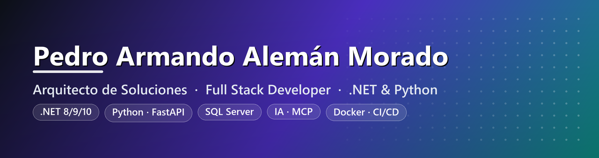

  

<h1 align="center">Pedro Armando Alemán Morado</h1>

<h3 align="center">Arquitecto de soluciones y desarrollador Full Stack · .NET · SQL Server · Python</h3>

  
  
  

Desarrollo software empresarial a medida, modernizo sistemas existentes e integro aplicaciones para automatizar procesos. Atiendo proyectos freelance en remoto, independientes de mi empleo institucional.

## Servicios

| Servicio | Qué resuelvo | Respaldo técnico |
|---|---|---|
| **Software empresarial a medida** | Aplicaciones web y APIs con usuarios y permisos, flujos de trabajo y reportes; una sola plataforma para varias empresas o sucursales. | ASP.NET Core · Web API · SQL Server · diseño multitenant · Clean Architecture |
| **Mantenimiento y modernización** | Diagnóstico de sistemas heredados, optimización de consultas, corrección de errores, migración a .NET actual y documentación técnica. | T-SQL · procedimientos almacenados · auditoría y migración de datos · .NET 8/9/10 |
| **Integraciones y automatización** | Conexión de sistemas por API, sincronización de datos y tareas automáticas; IA mediante API cuando aporta valor. | APIs REST · FastAPI · servicios en segundo plano · Docker · GitHub Actions |

## Experiencia

**Programador de sistemas — Universidad Autónoma de Tamaulipas**
Desarrollo y mantenimiento de sistemas de información institucionales con Microsoft SQL Server.

> Los sistemas institucionales en los que he trabajado son confidenciales, por lo que no publico sus nombres, capturas, código ni datos.

## Tecnologías

| Área | Tecnologías |
|---|---|
| **Lenguajes** | C# · Python · JavaScript · T-SQL · HTML5 · CSS3 · PowerShell |
| **.NET** | .NET 8/9/10 · ASP.NET Core · Web API · Razor / MVC · Dapper · autenticación JWT y cookies · AutoMapper · FluentValidation · servicios en segundo plano |
| **Datos** | Microsoft SQL Server (T-SQL, procedimientos almacenados, modelado, auditoría y migración) · diseño multitenant · MongoDB · Redis |
| **Python e IA** | FastAPI · Pydantic · OpenCV · MediaPipe · Ultralytics YOLO · OCR · visión computacional · biometría facial y prueba de vida · integración de LLM mediante API |
| **Frontend** | Bootstrap 5 · JavaScript modular · ESBuild · AJAX · PWA · notificaciones push · políticas CSP estrictas |
| **Infraestructura** | Docker · Docker Compose · Nginx · VPS Linux · IIS · SSH · GitHub Actions · CI/CD |
| **Arquitectura** | Clean Architecture · multitenant · servicios desacoplados · SOLID · DRY · separación de responsabilidades · modelado de dominio · APIs REST |

**Desarrollo asistido por IA:** ChatGPT, Claude, DeepSeek y GitHub Copilot · Claude Code con subagentes y skills · MCP para consultar esquemas y procedimientos de SQL Server · archivos de contexto por proyecto (`CLAUDE.md`, `AGENTS.md`) · control de consumo y costo de IA.

**Aprendiendo actualmente:** preparación para la certificación Google Cloud Professional Cloud Architect · orquestación de agentes · Google Agent Development Kit · MLOps · BigQuery · Dataflow · context engineering.

## Certificaciones

| Certificación | Fecha | Estado |
|---|---|---|
| Microsoft Certified: Azure Fundamentals | abril 2023 | Vigente |
| Microsoft Certified Technology Specialist: SQL Server 2005 | mayo 2008 | Histórica (retirada por Microsoft) |
| Microsoft Certified Technology Specialist: .NET Framework 2.0, Web Applications | marzo 2008 | Histórica (retirada por Microsoft) |

[Historial de certificaciones en Microsoft Learn](https://learn.microsoft.com/es-mx/users/pedroalemnmorado-2485/transcript/d8y2jfp6mxollk0)

## Cómo trabajo

- Primero entiendo el proceso y el problema; después elijo la tecnología.
- Trabajo por etapas, con avances revisables.
- Documentación del sistema como parte de la entrega.
- Entregables, accesos y derechos de uso definidos por escrito según el alcance contratado.

El alcance, calendario de entregas y horarios de comunicación se acuerdan al iniciar cada proyecto.

## Contacto

¿Tienes un sistema que mejorar o un proceso que automatizar? Envíame una consulta desde mi perfil de LinkedIn con una breve descripción de tu caso.

  
  

Atención remota desde Ciudad Victoria, Tamaulipas · Última actualización: noviembre 2026

